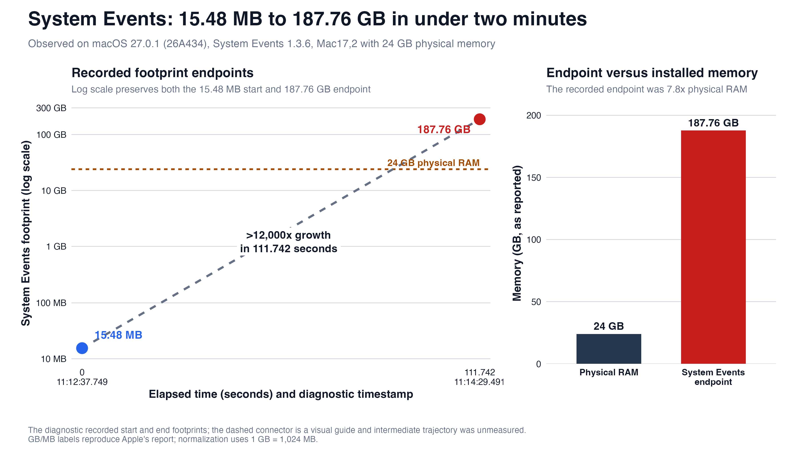

# When System Events Reported a 187.76 GB Footprint: A Forensic Case Study of Agent-Generated Accessibility Enumeration on macOS

Taylor McCoy<br>
October 27, 2026

> **Disclosure status:** Private coordinated-disclosure manuscript. This repository contains sanitized evidence and disabled reproduction material; raw Apple diagnostics and private session records remain in the separate disclosure archive.

## Abstract

I investigated an extreme memory event on a Mac17,2 with an Apple M5, 24 GB of physical memory, and macOS Golden Gate 27.0.1 (26A434). A local coding agent was inspecting Microsoft Outlook through AppleScript and JavaScript for Automation when it generated broad accessibility queries, including recursive `uiElements()` traversal and `entire contents` enumeration through Apple's `System Events` process. Apple's first CPU-resource diagnostic measured the process footprint increasing from 15.48 MB to 187.76 GB in 111.742 seconds while averaging 66% CPU. Under the unit normalization used in this study, that was a 12,420.30-fold endpoint increase and an endpoint equal to 7.82 times installed physical memory. A later jetsam record accounted 222.55 GiB to the process. After `System Events` was relaunched and broad queries were repeated, a fresh process entered the same stack family; its measured footprint rose from 110.64 MB to 4,248.64 MB in 91.488 seconds, and a later jetsam record reported a 253.91 GiB lifetime maximum. Both diagnostics repeatedly sampled one `System Events` offset followed by Foundation scripting-property lookup in `NSScriptClassDescription`.

The evidence establishes a local availability failure associated with broad accessibility enumeration and unbounded scripting work. Apple's closed source leaves the exact failed invariant unknown. I model a plausible prompt-injection delivery chain because an agent with shell, Automation, Accessibility, and network authority could combine otherwise separate capabilities. The accompanying model is deliberately non-deployable: it uses one fixed synthetic record, surfaces a zero-width character, and replaces real data access, `System Events` execution, and network egress with fail-closed stubs. This case demonstrates why agent controllers need content/tool separation, narrow accessibility selectors, recursion and memory budgets, retry suppression, independent process monitoring, and egress controls that remain effective during local resource exhaustion.

**Keywords:** macOS; System Events; AppleScript; accessibility; resource exhaustion; prompt injection; agent security; forensic case study; denial of service

## Introduction

At approximately 11:12 local time on October 27, 2026, a coding agent working in my logged-in session attempted to inspect Outlook's interface. The agent first used a narrow `System Events` query, then wrote a JavaScript for Automation helper that recursively called `uiElements()` to a nominal depth of six without a global node limit, cycle check, memory limit, or wall-clock budget. It next generated AppleScript using `entire contents of front window` and bulk property retrieval. Within the same interval, Apple's diagnostic system recorded `System Events` growing from megabytes to a reported 187.76 GB footprint.

The number was startling because the Mac contained 24 GB of physical memory. Process footprint can exceed physical RAM through virtual-memory accounting, compression, swap, and retained allocation. I therefore treated 187.76 GB as Apple's memory-accounting value and analyzed network activity as a separate measurement domain. The central empirical questions were direct: what local process entered the runaway state, which recorded actions preceded it, did the behavior recur in a fresh process, and what security boundary failed?

`System Events` is a first-party automation bridge. macOS separately controls whether one application may automate another, and accessibility-based UI scripting requires an already authorized local host (Apple Inc., n.d.-a). Foundation's documented scripting machinery includes `NSScriptSuiteRegistry`, which manages scripting terminology, and `NSScriptClassDescription`, which maps Apple-event codes to scriptable keys (Apple Inc., n.d.-b, n.d.-c). Those documented roles are relevant because the preserved stacks repeatedly traverse `-[NSScriptClassDescription keyWithAppleEventCode:]` and a private property-description lookup. The private implementation and failed guard remain undisclosed.

I asked five questions:

1. Which process and command sequence preceded the memory event?
2. Did a fresh `System Events` process enter the same stack family after broad queries were repeated?
3. How large was the observed change relative to its starting footprint and installed memory?
4. What can the record support about prompt injection, malware, and exfiltration?
5. Which controls would have prevented or contained the event without requiring an Apple patch?

This two-episode forensic case study uses descriptive statistics. Population frequency and source-level defect remain unknown.

## Methods

### Case design and system

I conducted a retrospective, single-machine forensic case study. The assessed system was a Mac17,2 with an Apple M5, 24 GiB of physical memory, macOS Golden Gate 27.0.1 (26A434), and `System Events` 1.3.6 (build 607). Microsoft Outlook was the UI target. The initiating commands ran locally through `osascript` from an automation-capable coding-agent workflow. Existing Automation and Accessibility permissions supplied the required privileges.

I refer to two fresh-process episodes:

- **Episode 1:** `System Events` PID 40483, associated with the first recursive and bulk Outlook queries.
- **Episode 2:** `System Events` PID 41643, launched after the first responder was terminated and exposed to repeated broad queries.

### Evidence preservation

The primary evidence comprised two Apple CPU-resource diagnostics, two Apple jetsam records, and the local automation-session record. I preserved the four Apple artifacts outside Git because diagnostic bundles can expose host and process metadata. Their SHA-256 values, derived numerical fields, and selected stack markers are recorded in [`evidence/sanitized/observations.json`](evidence/sanitized/observations.json). The command sequence is reduced to a privacy-preserving chronology in [`docs/forensic-timeline.md`](docs/forensic-timeline.md). Sanitization removes message bodies, account identifiers, credentials, serial numbers, hardware UUIDs, and private email content.

I matched events by local timestamp, process identifier, executable, Apple-event direction, and diagnostic interval. The first broad recursive helper executed at 11:12:34.866; the first diagnostic footprint measurement began 2.883 seconds later. The repeated `entire contents` helper executed at 11:21:00.713; the second footprint interval began 2.828 seconds later. Temporal order establishes association. Matching stack families and fresh-process recurrence supply the mechanistic evidence.

### Public-source review

I read Apple's Automation guidance, the complete accessible documentation for `NSScriptClassDescription` and `NSScriptSuiteRegistry`, Apple's Security Bounty guidelines, and every vulnerability record in Apple's macOS 27.2 security advisory. The advisory contained 263 structured vulnerability records and included zero `System Events`, AppleScript, or Automation entry matching this trigger (Apple Inc., 2026). I also read OWASP's prompt-injection entry and MITRE's CWE-400 entry in full (MITRE, 2026; OWASP Foundation, 2025). A source-coverage ledger is preserved in [`references/SOURCE-READING-LOG.md`](references/SOURCE-READING-LOG.md), and the APA references are in [`REFERENCES.md`](REFERENCES.md).

### Agent and command attribution

I treated the recorded shell and automation commands as the direct action layer. The local agent generated the risky query shapes while troubleshooting Outlook. Earlier prompt provenance is unavailable. Prompt origin remains unknown, and prompt injection remains a plausible threat-model path.

Command provenance supplies the strongest attribution: a local agent workflow authored and executed broad `osascript` requests under my session's existing permissions. The identity and intent of any hypothetical upstream attacker remain unknown.

### Non-deployable threat simulation

I implemented a safe model of the larger chain in [`simulation/nondeployable_chain.py`](simulation/nondeployable_chain.py). It demonstrates four boundaries: untrusted content, a policy decision, synthetic staging, and omitted dangerous capabilities. The input contains one visible marker and one U+200B zero-width space. The program renders an escaped view, treats the text as data, and stages only the fixed non-secret byte string `DEMO-RECORD-NOT-PRIVATE`.

The model's capability surface is fixed synthetic data and local reporting. Real data access, process launch, AppleScript invocation, destination contact, and byte transmission terminate at functions that raise `CapabilityIntentionallyOmitted`. Five tests verify capability omission, hidden-character surfacing, fixed fixture hash, stage status, and command-line report. This supplies a concrete defensive review target.

### Safety constraints

Investigation safety boundary: the hazardous query remained unexecuted. The affected Mac remains on macOS 27.0.1 at my request, with system patch and configuration state preserved. Active validation belongs on a disposable test Mac with an independent watchdog, a second control channel, hard time and memory limits, and a plan to terminate both the caller and the specific `System Events` instance.

## Data Analysis and Statistics

I analyzed two observed episodes (`n = 2`) descriptively. Inferential significance testing and exploitation-probability estimation would be invalid for this selected two-case sample: query forms differed, random sampling was absent, and later jetsam measurements occurred outside the CPU-resource intervals.

For a diagnostic endpoint reported in GB, I normalized the reported units using the figure's explicit convention of `1 GB = 1,024 MB`. This declared arithmetic convention compares Apple's printed MB and GB labels; Apple's diagnostic documentation for the unit base was unavailable. The growth multiple was:

```text
normalized endpoint / starting endpoint
```

The endpoint-derived mean change was:

```text
(normalized endpoint - starting endpoint) / measured interval seconds
```

That quantity summarizes two endpoints. Intermediate allocation behavior was unmeasured, so I report it as an endpoint-derived mean change. The physical-memory multiple was the reported endpoint or jetsam GiB value divided by 24 GiB. The mean trigger-to-measurement lag was calculated from the two matched command and interval-start timestamps. [`analysis/analyze_observations.py`](analysis/analyze_observations.py) reproduces every derived value from the sanitized JSON.

| Measure | Episode 1 | Episode 2 |
| --- | ---: | ---: |
| Starting footprint | 15.48 MB | 110.64 MB |
| Measured endpoint | 187.76 GB | 4,248.64 MB |
| Normalized endpoint (1 GB = 1,024 MB) | 192,266.24 MB | 4,248.64 MB |
| Measured interval | 111.742 s | 91.488 s |
| Growth multiple | 12,420.2997× | 38.4006× |
| Endpoint-derived mean change | 1,720.4879 MB/s | 45.2300 MB/s |
| Endpoint / physical memory | 7.8233× | 0.1729× |
| Average CPU in diagnostic | 66% | 67% |
| Broad-query-to-measurement lag | 2.883 s | 2.828 s |
| Later jetsam comparison | 9.2728× physical memory | 10.5795× physical memory at lifetime maximum |

The arithmetic mean of the two diagnostic CPU averages was 66.5%. The mean temporal lag was 2.8555 seconds. Both episodes showed the same three selected stack markers. Population reliability and prevalence remain unestimated.



**Figure 1.** Recorded first-episode endpoints. The dashed connector visually links them; intermediate trajectory was unmeasured. The right panel compares the reported endpoint with installed physical memory.

## Results

### 1. The runaway process was Apple's System Events

**Observed.** Apple's first CPU-resource diagnostic identified `System Events` PID 40483 and measured its footprint from 15.48 MB to 187.76 GB between 11:12:37.749 and 11:14:29.491. The process accumulated 90 CPU seconds in a 136-second report window, approximately 66% average CPU. The immediate `osascript` caller returned while `System Events` continued working.

**Observed.** The later jetsam record identified the same PID at 14,584,802 resident pages. At the report's 16 KiB page size, that equals 222.5464 GiB, or 9.2728 times installed physical memory.

### 2. The diagnostic stack repeatedly crossed the scripting-property path

**Observed.** The first heaviest stack contained many consecutive frames at `System Events + 10792`, followed by `-[NSScriptClassDescription keyWithAppleEventCode:]` and `_propertyDescriptionForAppleEventCode:checkSubclasses:`. Other samples passed through `NSAppleEventManager`, `NSScriptingAppleEventHandler`, repeated script-object-specifier evaluation, and descriptor construction.

**Inferred.** The stack shape is consistent with repeated or recursive expansion in the scripting bridge while it resolves accessibility objects and properties. The specific failed invariant—cycle handling, repeated class lookup, object-specifier recursion, descriptor construction, cancellation, or a combination—remains unknown.

### 3. A fresh process reproduced the same stack family

**Observed.** After the first responder was terminated, new `System Events` PID 41643 received repeated broad Outlook queries. Its diagnostic measured 110.64 MB to 4,248.64 MB in 91.488 seconds at approximately 67% CPU. The selected stack markers matched Episode 1. A later jetsam record reported 16,639,984 resident pages and a lifetime maximum of 16,640,096 pages, equal to 253.9060 and 253.9077 GiB.

**Inferred.** Fresh-process recurrence implicates the broad query and target interaction independent of first-process history. General reproducibility across systems and applications remains unknown.

### 4. The recorded agent workflow supplied the direct trigger sequence

**Observed.** The local workflow generated recursive `uiElements()` traversal, `entire contents of front window`, bulk property retrieval, and retries. These commands preceded both measured intervals and originated during Outlook troubleshooting.

**Unknown.** The preserved record lacks upstream-content provenance for the commands. Any hidden instruction or upstream actor remains unidentified.

### 5. Availability impact and network-measurement scope

**Observed.** The process footprint and jetsam accounting exceeded physical memory many times over and created severe compression and swap pressure. Terminating the runaway responder restored a healthy state. A 12:38:18 read-only check found no `System Events` process running, 83% system-wide memory free, and 1,877.12 MB of encrypted swap still in use. A second check at 12:54:55 again found no responder, 78% memory free, and 1,219.19 MB of 2,048 MB encrypted swap in use. macOS remained 27.0.1 (26A434).

**Observed.** Apple's 187.76 GB value records memory accounting. Incident-window network telemetry, staged archives, destinations, credential-use traces, and persistence records were unavailable in the preserved artifacts.

**Inferred.** A separate malicious component could attempt data access and egress while using resource exhaustion as distraction or destructive cover. Collection, staging, and egress require separate capabilities.

### 6. macOS 27.2 advisory status

Apple's macOS 27.2 advisory, dated October 26, 2026, contains zero `System Events`, AppleScript, or Automation entry matching this trigger among its 263 vulnerability records (Apple Inc., 2026). I left 27.2 untested; affected range and repair status remain unknown.

## Discussion

### A local availability primitive with an agent delivery path

The narrow finding is a local availability primitive. Code already running under the logged-in user, with the required Automation and Accessibility grants, can ask a first-party responder to expand a complex accessibility hierarchy. In this case, the responder continued expensive work after the requesting process returned and reached a footprint far beyond physical memory. The behavior aligns conceptually with uncontrolled resource consumption. CWE-400 remains a high-level descriptor; MITRE recommends the most specific available implementation weakness, and Apple's closed source leaves that weakness unknown (MITRE, 2026).

Agent systems make this primitive more consequential because they can connect untrusted content to tools. OWASP describes both direct and indirect prompt injection, including hidden or obfuscated instructions, and recommends constrained behavior, least privilege, separation of untrusted content, and human approval for high-impact actions (OWASP Foundation, 2025). This incident establishes the dangerous downstream half: an agent-generated command, an already authorized automation surface, and a first-party process that failed under an expansive request. Prompt origin remains unknown.

The safe threat chain is:

```text
untrusted content
  -> model or controller mistakes data for authority
  -> already-authorized local automation invokes a broad UI query
  -> System Events performs unbounded scripting work
  -> compression, swap, jetsam, and local availability loss
```

A larger malicious chain could add data access, staging, and outbound transport. Those capabilities should be analyzed separately:

```text
data access -> bounded staging -> independently governed egress
                               \
                                +-> separate resource-exhaustion distraction
```

The separation matters. Resource containment governs local availability; egress policy governs outbound transfer. A secure agent runtime needs both.

### The Backspace boundary

My separate Backspace Gate work showed that a terminal recording can preserve echoed bytes for a draft that is later visually erased even when canonical line editing delivers only the committed line to the child process (McCoy & Blu, 2026). That result motivates byte-level evidence preservation and an escaped code-point view. Its measured scope is the terminal recorder boundary. Delivery of erased text into Outlook, a cloud model, or this agent workflow was unmeasured. Terminal display, recorder output, process input, model input, model output, and tool execution remain distinct evidence layers.

### Defensive controls

The most important client-side control is to reject broad query shapes before execution. `entire contents`, `every UI element`, recursive `uiElements()`, unrestricted property retrieval, and whole-process enumeration should require a narrower plan. Accessibility traversal should use a visited-object set plus explicit depth, node, result-size, time, and memory budgets. A first hang or abnormal slowdown should stop the workflow; a controller should not relaunch the responder and retry through another broad route.

The agent boundary needs separate authorities for content reading, shell execution, UI automation, sensitive-data access, and networking. Untrusted message and document text should remain data. Proposed commands should be logged and screened independently of the model that generated them. An out-of-process monitor should watch the new `System Events` PID and terminate the request at a conservative growth threshold. Network destination allowlists, egress logging, rate limits, and data-loss controls should remain outside the potentially exhausted process tree.

Apple's responder can provide the final containment layer. Each inbound event should have budgets for recursion, visited objects, result count, descriptor size, elapsed time, and allocation. Cycle detection should cover accessibility objects, script object specifiers, class-description traversal, and descriptor construction. Sender exit and cancellation should end outstanding work. Limit breaches should release intermediate objects, return a bounded error, and leave `System Events` responsive.

### Additional holes identified

- **Retry amplification:** a controller can relaunch `System Events` and reproduce the pressure after treating a hang as a transient failure.
- **Caller/responder lifetime mismatch:** the requesting `osascript` process can return while the first-party responder continues expensive work.
- **Permission concentration:** shell, Automation, Accessibility, sensitive-data access, and network authority in one agent process create an unnecessarily large blast radius.
- **Content opacity:** zero-width, bidirectional, and control characters can create different byte, rendered, tokenizer, and parser views.
- **Diagnostic privacy:** raw CPU, jetsam, and sysdiagnose artifacts can expose unrelated process and machine information.
- **Monitoring fragility:** an in-process monitor may fail with the workload it is meant to contain; the watchdog needs an independent control path.
- **Version uncertainty:** the current production observation is on 27.0.1, while 27.2 remains untested.
- **Target variability:** generalizability to other applications, UI states, and data volumes remains unmeasured.

### Disclosure and bounty readiness

Apple's Security Bounty guidelines ask for a clear, actionable report with reliable reproduction and testing on the latest publicly available software (Apple Security Research, n.d.). This repository contains strong diagnostics, recurrence, command attribution, a disabled trigger shape, and proposed regression tests. It is ready for private Apple triage. Latest-release validation and controlled lab replay remain the two missing elements for a stronger bounty package.

I would submit the evidence privately now for early vendor notice and report 27.2 status as unknown. A stronger bounty package would add one bounded reproduction on a disposable Mac running the latest public release, a narrow-query negative control, an independent watchdog trace, and measurement of responder cancellation after caller termination. This production Mac is excluded from active replay.

### Limitations

This study contains two episodes on one Mac, one operating-system build, one target application, and one local user session. The query sequence lacked factorial control. The first and second measured endpoints differ substantially, and the later jetsam records were recorded outside the CPU-report intervals. Raw artifacts remain private, limiting independent review to the sanitized record until vendor disclosure.

Apple's relevant source is closed, leaving the source-level root cause unknown. The 27.2 advisory review found zero named entry; unlisted implementation changes remain outside public visibility. Incident-window network telemetry was unavailable. The coding agent generated the unsafe commands, while upstream prompt provenance remains unknown.

## Conclusion

A local coding-agent workflow issued broad Outlook accessibility requests through `System Events` on macOS 27.0.1. Apple's first diagnostic measured the responder growing from 15.48 MB to a reported 187.76 GB footprint in 111.742 seconds, a normalized 12,420.30-fold increase and 7.82 times installed physical memory. A fresh process later reproduced the same stack family, and the two jetsam records reached 222.55 and 253.91 GiB accounting values.

The supported outcome is severe local resource exhaustion in a first-party automation responder. The exact defect, affected-version range, prompt-injection origin, and repair status remain unknown. Apple's 187.76 GB value quantifies process footprint; outbound byte volume was unmeasured. The broader security lesson is concrete: an agent that combines untrusted content, powerful local automation, retry behavior, and concentrated permissions can turn an ordinary troubleshooting request into system-wide availability loss. Narrow query design, explicit budgets, independent monitoring, separated capabilities, and fail-closed egress controls would materially reduce that risk today.

## Declarations

### Data and code availability

Sanitized observations, derived statistics, the figure generator, defensive linter, disabled trigger text, and non-deployable simulation are preserved in this private repository. Raw Apple diagnostics and private session records are retained separately for vendor disclosure because they contain unnecessary host and process metadata.

### AI assistance

OpenAI Codex assisted with read-only forensic inspection, arithmetic reproduction, source review, defensive code, testing, figure production, and manuscript drafting under my direction. I retained the claim boundaries, source-selection rule, disclosure decision, and final authorship responsibility. The incident itself involved a separate local coding-agent workflow; that workflow's generated commands are part of the evidence under study.

### Safety and ethics

Safety actions: the disabled trigger remained unexecuted; review stayed within the owner's account and data; simulation capability stayed limited to fixed synthetic input and fail-closed stubs. The affected production Mac was left on macOS 27.0.1 at my request and remains unsuitable for active replay.

### Competing interests

I report no financial competing interest. A potential Apple Security Bounty submission may create a future financial interest; no award, eligibility decision, CVE, or Apple confirmation exists at the time of writing.

## References

APA-formatted references and the complete-source review ledger are available in [`REFERENCES.md`](REFERENCES.md) and [`references/SOURCE-READING-LOG.md`](references/SOURCE-READING-LOG.md).
