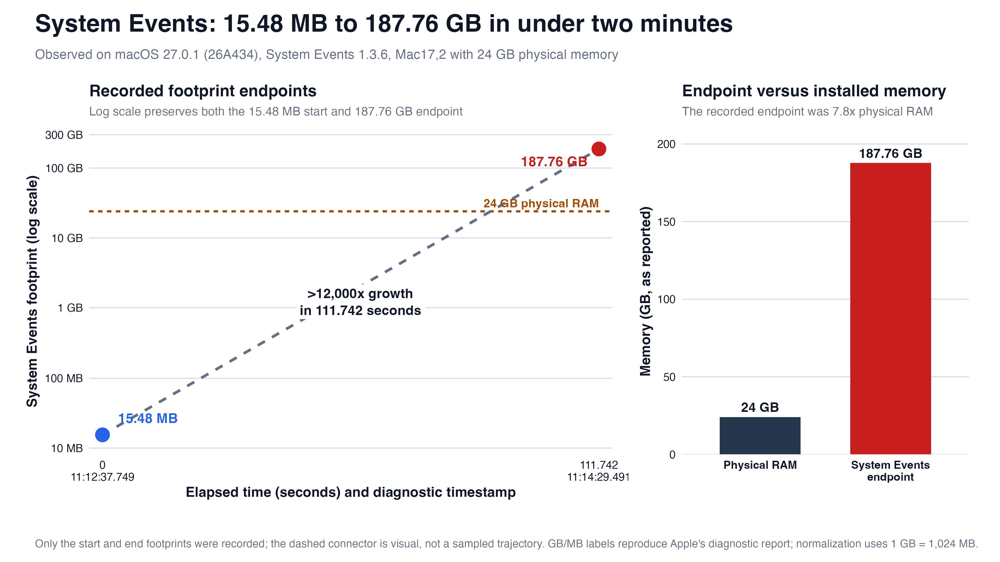

# macOS System Events memory exhaustion

Private coordinated-disclosure package for a reproducible availability defect observed in Apple's `System Events` scripting bridge on macOS 27.0.1 (26A434).

> **Private disclosure status:** Do not make this repository public or publish the proof of concept before Apple has had a reasonable opportunity to investigate and coordinate remediation.



## What happened

A local automation process with macOS Automation and Accessibility permission inspected Microsoft Outlook through `System Events`. After recursive and unbounded accessibility-tree enumeration, the first-party `System Events` process entered a recursive scripting-metadata path and exhausted memory.

The first Apple CPU-resource diagnostic measured `System Events` growing from **15.48 MB to 187.76 GB in 111.742 seconds** while averaging 66% CPU. The Mac had 24 GB of physical memory. A later jetsam record accounted approximately 222.55 GiB to that process. After `System Events` was relaunched and broad accessibility queries were repeated, the second instance later accounted approximately 253.91 GiB.

The observed impact is local availability loss and extreme memory/swap pressure. The evidence does not establish remote reachability, data exfiltration, code execution, privilege escalation, a CVE, a fixed release, or bounty eligibility.

## Repository map

- `report/` — Apple-ready technical disclosure report.
- `docs/forensic-timeline.md` — sanitized event and attribution timeline.
- `docs/agent-threat-model.md` — bounded analysis of agent prompt-injection and denial-of-service risk.
- `evidence/sanitized/observations.json` — machine-readable values derived from Apple diagnostics.
- `figures/` — source data, reproducible generator, SVG, and PNG.
- `poc/` — disabled trigger text and a non-executing review harness. **Do not execute the trigger on a production Mac.**
- `tools/lint_system_events.py` — heuristic guard against the unbounded automation patterns involved here.

Raw `.diag` and `.ips` files are intentionally excluded from Git. They remain preserved separately for a private Apple submission because they can contain host-specific process inventories and identifiers.

## Immediate mitigation

Do not use `entire contents`, `every UI element`, `every application process`, or recursive `uiElements()` traversal through `System Events` on a complex application. Use targeted accessibility selectors with explicit depth, node-count, memory, and time limits. If automation hangs, terminate both the requesting process and the newly launched `System Events` instance before retrying through a narrower route.

Run the local heuristic guard before accepting AppleScript or JXA automation:

```sh
python3 tools/lint_system_events.py path/to/script.applescript
```

## Validation status

- Runtime failure: observed twice on macOS 27.0.1 (26A434).
- Attribution: matched to local Terminal-launched `osascript` commands and a recorded coding-agent workflow.
- Current machine state: healthy after process termination; no active runaway remained.
- macOS 27.2: available but deliberately not installed or tested at the owner's request; Apple's public 27.2 security notes do not identify this specific defect.
- Vendor source: unavailable because the relevant Apple implementation is closed source. The report is runtime-evidence-based and keeps source-dependent conclusions conditional.

## Disclosure handling

See [SECURITY.md](SECURITY.md). Preserve the private repository and raw evidence until Apple assigns a case identifier and provides disclosure guidance.
