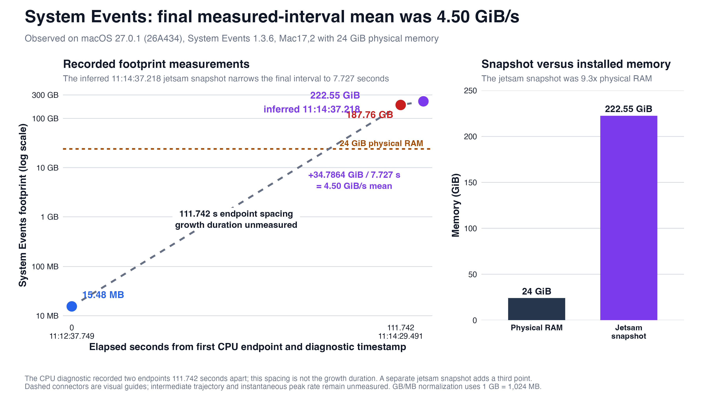

# System Events memory exhaustion during recursive accessibility enumeration

## Executive Summary

A local user or automation process that already has macOS Automation and Accessibility authorization can ask the first-party `System Events` process to enumerate a complex application's accessibility hierarchy and retrieve broad property sets. In two recorded runs on macOS Golden Gate 27.0.1 (26A434), recursive and bulk queries against Microsoft Outlook were followed by sustained recursion in System Events and Foundation scripting code, rapid process-footprint growth, heavy CPU use, severe memory and swap pressure, and the need to terminate System Events. The demonstrated security impact is local availability loss through uncontrolled resource consumption. The exact source defect and affected-release range remain unknown.

The assessed system was a Mac17,2 with an Apple M5 and 24 GB of physical memory. It ran System Events 1.3.6 (build 607). During the first incident, an Apple CPU-resource diagnostic measured the System Events footprint growing from 15.48 MB to 187.76 GB between 11:12:37.749 and 11:14:29.491, a 111.742-second interval, while the process averaged approximately 66% CPU. A later jetsam record accounted approximately 222.55 GiB to that process. A new System Events instance entered the same recursive path after further broad accessibility queries and was later accounted at approximately 253.91 GiB. These measurements are preserved in the [sanitized observations](../evidence/sanitized/observations.json), [forensic timeline](../docs/forensic-timeline.md), and [footprint figure](../figures/system-events-footprint.png).

I reviewed the preserved Apple CPU-resource diagnostics, jetsam records, local Apple-event attribution, and recorded automation sequence. Review boundaries were deliberate: the trigger remained disabled, Apple's System Events and Foundation source was unavailable, and macOS 27.2 remained untested. The earliest affected release, complete affected range, exact defective source path, and fixed release are unknown. Apple's [published 27.2 security content](https://support.apple.com/en-us/149521) contains zero matching System Events, AppleScript, or Automation entry.

## Background

System Events is a scriptable macOS process that exposes system and application objects to AppleScript and JavaScript for Automation. In the assessed topology, a local coding agent launched `osascript` from Terminal, the script sent Apple events to System Events, and System Events traversed Outlook's accessibility objects. Terminal or the automation host needed permission to control other applications, and UI scripting needed Accessibility authorization. Those existing local grants supplied the required privileges. Apple's [Automation privacy guidance](https://support.apple.com/guide/mac-help/mchl07817563/mac) describes the user-controlled permission for one application to control another.

Apple documents the relevant Cocoa scripting machinery at a high level. An [`NSScriptSuiteRegistry`](https://developer.apple.com/documentation/foundation/nsscriptsuiteregistry) collects a scriptable application's terminology and converts incoming Apple events into script commands. It creates and retains [`NSScriptClassDescription`](https://developer.apple.com/documentation/foundation/nsscriptclassdescription) objects, whose `key(withAppleEventCode:)` method maps an Apple-event property or element code to the corresponding key. Those documented roles match the Foundation symbols in the recorded stacks. The private implementation and failed guard remain undisclosed.

A finite accessibility query should complete, return a bounded error, or be cancelled without leaving the responder consuming resources after the requesting process exits. Complex or cyclic UI object graphs are foreseeable input for an accessibility bridge. System Events should therefore bound recursion, repeated-object traversal, result construction, and the lifetime of work associated with one Apple event.

The observed prerequisites were:

- local code execution in the logged-in user's context;
- an automation host allowed to send Apple events to System Events and inspect another application's UI through Accessibility;
- a complex target accessibility hierarchy; and
- broad enumeration and property requests across the accessibility hierarchy.

Reliability across query forms and application hierarchies remains unknown. The required privacy grants depend on local configuration; deployment prevalence was unmeasured.

## Vulnerability Details

The recorded automation sequence used several unsafe query shapes in close succession: a JavaScript for Automation tree walk with a nominal depth limit of six but no node-count, cycle, or time budget; AppleScript requesting `entire contents of front window`; bulk retrieval of the properties of every UI element; and retries after earlier requests failed to produce a useful result. The local agent generated these commands during an Outlook inspection workflow. The [forensic timeline](../docs/forensic-timeline.md) preserves the causal sequence while omitting private message content.

For the first run, Terminal-launched `osascript` started System Events PID 40483 and sent two property-get Apple events, identified as the Core suite `get data` operation (`core/getd`). The requester exited normally, but System Events remained active and continued consuming CPU and memory. The CPU-resource diagnostic recorded:

- System Events 1.3.6 (build 607) on macOS 27.0.1 (26A434);
- 90 seconds of CPU time over 136 seconds, approximately 66% average CPU;
- footprint growth from 15.48 MB to 187.76 GB in 111.742 seconds; and
- a heaviest stack with many consecutive frames at one System Events offset followed by `-[NSScriptClassDescription keyWithAppleEventCode:]` and `_propertyDescriptionForAppleEventCode:checkSubclasses:`.

Other samples in the same diagnostic pass through `NSAppleEventManager`, `NSScriptingAppleEventHandler`, repeated `NSScriptObjectSpecifier objectsByEvaluatingSpecifier`, and deeply repeated `_createdDescriptor` frames. The later 11:35 jetsam record names System Events as the largest process and records 14,584,802 resident pages at a 16 KiB page size, approximately 222.55 GiB.

After System Events was relaunched, a second instance, PID 41643, received further broad Outlook accessibility requests. Its CPU diagnostic measured growth from 110.64 MB to 4,248.64 MB in 91.488 seconds at approximately 67% average CPU, with the same repeated System Events offset and `NSScriptClassDescription` property-code traversal. At 12:13, the second jetsam record again names System Events as the largest process and records a lifetime maximum of 16,640,096 pages, approximately 253.91 GiB. The [sanitized observations](../evidence/sanitized/observations.json) contain the machine-readable values used here, and the [first-run figure](../figures/system-events-footprint.png) visualizes the measured endpoints without implying unobserved intermediate samples.



Together, the two fresh-process runs, temporal attribution to local Apple events, and matching recursive stacks establish a runtime failure in System Events' handling of broad accessibility object/property requests. The observed failure mode is recursive scripting-metadata and object-specifier evaluation without an effective resource bound. Apple's closed source leaves the underlying defect among several plausible mechanisms: a cycle in the target object graph, repeated subclass/property lookup, recursive descriptor construction, inadequate cancellation, or a combination. The introducing change and affected-version range remain unknown.

The second run is a useful recurrence control: a newly launched System Events process reached the same stack family after the broad requests were repeated. Fresh-process recurrence implicates the request/target interaction independent of first-process history. A safe bounded-query negative control and candidate fixed-build comparison remain pending because this production Mac was excluded from replay.

## Exploitability Analysis

The narrow primitive is local denial of service through resource exhaustion in a privileged first-party automation responder. An actor must already be able to run local automation with Automation and Accessibility authorization. Under those prerequisites, broad UI enumeration can leave System Events allocating and recursing after the immediate `osascript` caller has exited. The two observed runs show that the effect can exceed physical RAM many times over and drive system-wide compression, swap, and jetsam activity. Recovery required terminating the runaway responder. Jetsam records show aggregate low-swap pressure and many processes; the simultaneous kill set and user-work loss remain unknown.

An automation-capable agent creates a plausible additional delivery path. If the agent reads attacker-controlled mail, web content, or a document and treats a malicious hidden prompt as an instruction, that prompt could ask it to enumerate an entire UI tree or retrieve every property through System Events. An agent that is allowed to invoke `osascript` and already holds the required privacy grants could then trigger the same local availability failure. This chain depends on prompt ingestion, instruction-following, tool authorization, existing macOS grants, and a susceptible target hierarchy. The incident record establishes agent-authored Outlook inspection commands. Prompt origin remains unknown.

Apple's 187.76 GB value records process-memory footprint. Memory allocation, object and descriptor construction, compression, and swap accounting can amplify a small initiating request into a much larger footprint. Incident-window network telemetry was unavailable; preserved artifacts cover process, command, and memory activity.

A purpose-built malicious agent workflow could combine this availability primitive with separate capabilities for sensitive-data access, staging, and outbound transport. In such a chain, resource exhaustion could impair monitoring, terminate unrelated processes, disrupt response, or provide destructive cover while another component attempts exfiltration. Those separate components supply collection and egress. Defending against the complete chain requires both resource containment and independent egress controls.

Observed security impact is uncontrolled resource consumption and local availability loss. Reliability across other applications, hardware models, user sessions, and macOS releases remains untested. CVE and CVSS status: unassigned. Apple's [27.2 advisory](https://support.apple.com/en-us/149521) includes other denial-of-service and memory-safety fixes and contains zero entry for this component or trigger sequence.

## Proof of Concept

The repository contains two review-only reproduction aids:

- [`poc/trigger.applescript.disabled.txt`](../poc/trigger.applescript.disabled.txt) preserves the hazardous query shape as inert text. It must not be renamed or run on a production Mac.
- [`poc/bounded-repro.sh`](../poc/bounded-repro.sh) is a dry-run-first harness intended to show safeguards and the command that would be used in an explicitly approved disposable lab. Its default mode must remain non-executing.

From the report directory, the safe review path is:

```sh
cd ..
sh poc/bounded-repro.sh
```

This command exercises the harness's default dry run. The packaged reproducer was assembled after the incident and remains unexecuted. Runtime evidence comes from the pair of preserved CPU diagnostics, two jetsam records, and local Apple-event timeline summarized in [`evidence/sanitized/observations.json`](../evidence/sanitized/observations.json) and [`docs/forensic-timeline.md`](../docs/forensic-timeline.md).

Any future active validation should occur only on a disposable Mac with an independent watchdog, strict wall-clock and memory limits, a second control channel, and a plan to terminate both the requester and the specific System Events instance. It should begin with a narrow-query negative control, execute at most one bounded trigger attempt, preserve diagnostics, and stop immediately at abnormal growth. Authorization scope for this package is review only; active validation remains pending.

## Remediation

The following is proposed behavioral remediation. An upstream code patch requires Apple's private implementation and engineering validation.

The complete [`cooperative pause–drain–resume proposal`](../proposed-patch/cooperative-pause-drain-resume.md) defines the request state machine, checkpoint model, incremental cleanup behavior, emergency freeze, client compatibility layer, and validation criteria.

System Events and the underlying Cocoa scripting path should treat each inbound Apple event as a resource-bounded transaction. During object-specifier evaluation and descriptor construction, the implementation should track object identity and active traversal state so that cycles and repeated expansion terminate deterministically. It should enforce conservative limits on recursion depth, visited-object count, result count, descriptor size, elapsed time, and per-request allocation. A limit breach should cancel the request, release intermediate objects, return a bounded error to the sender, and leave System Events responsive.

The property-code path should also guard superclass and subclass traversal used by `keyWithAppleEventCode:` against cycles or repeated visits. Negative lookups should not repeatedly rebuild the same metadata graph. Work should be tied to the requesting Apple event's lifetime so that sender exit or cancellation stops outstanding evaluation, and memory-pressure notifications should provide a fail-safe cancellation path before swap is exhausted. Broad operations such as `entire contents` and bulk `properties` should be lazy, paginated, or rejected when their expansion cannot satisfy the request budget.

Apple's regression coverage should include:

- a deep but acyclic accessibility hierarchy that completes within a documented budget;
- a graph with repeated or cyclic accessibility references that returns a bounded error;
- `core/getd` property requests that require script-class key resolution across inheritance without revisiting the same class descriptions;
- nested object-specifier and descriptor construction with cancellation after the sender exits;
- repeated requests to a fresh and a long-lived System Events process;
- assertions that memory returns near baseline, CPU work stops, and System Events remains responsive after each rejected request; and
- comparison of macOS 27.0.1 with the candidate repaired build before assigning a fixed release.

Automation clients should independently avoid `entire contents`, `every UI element`, recursive `uiElements()` expansion, and bulk retrieval of all properties on complex applications. They should use a property allowlist, narrow selectors, breadth-first traversal with a visited-object set, and explicit depth, node-count, time, and memory budgets. Agent tool policies should reject or require deliberate review for broad System Events enumeration, even when untrusted content asks for it. The repository's `tools/lint_system_events.py` provides a heuristic client-side preflight. Apple-side repair and runtime containment remain necessary.

## Summary

On macOS 27.0.1 (26A434), a local automation process with Automation and Accessibility authorization issued broad Outlook UI queries through System Events 1.3.6 (build 607). System Events remained active after the requester exited, entered repeatedly recursive System Events/Foundation scripting stacks, and grew from 15.48 MB to 187.76 GB in under two minutes. A fresh second instance reproduced the same stack family and later reached an approximately 253.91 GiB jetsam accounting maximum. The demonstrated impact is local availability loss and severe resource pressure requiring termination of System Events.

Apple's closed source leaves the source-level root cause and affected-version range unknown. The most useful next validation is a single instrumented comparison of bounded and broad queries on a disposable 27.0.1 system, followed by the same regression set on an Apple-provided candidate build. Broad System Events accessibility enumeration should be treated as unsafe and constrained at the automation-client boundary.
